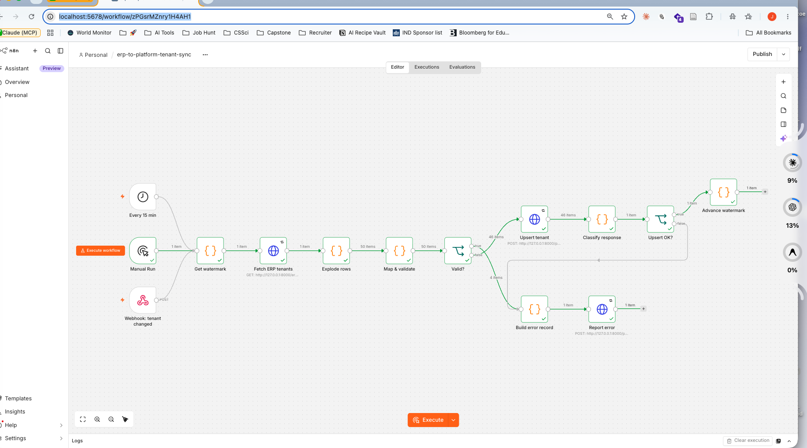
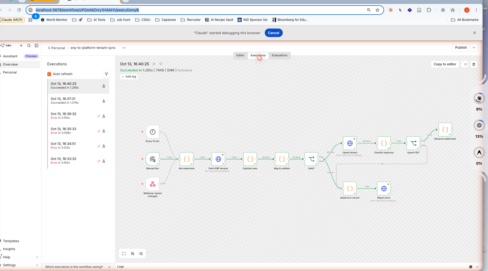
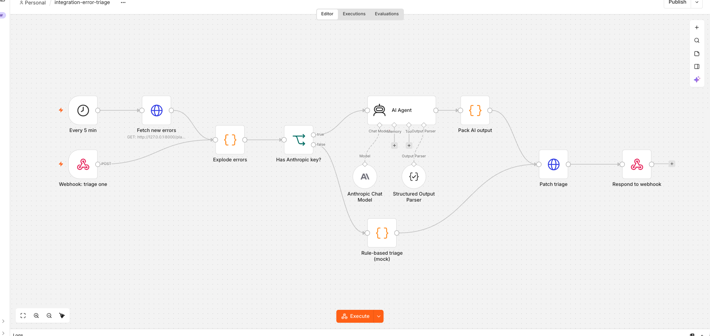
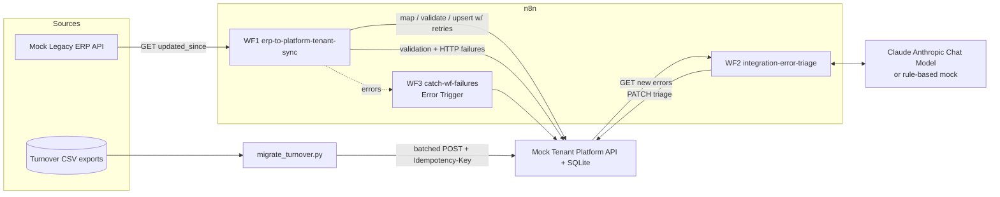

# n8n-integration-lab

A small reproducible lab that proves three Solutions-Engineering motions on a synthetic property-management domain: **build an n8n integration**, **run a one-shot data migration**, and **put a Claude agent inside the automation to triage integration errors**.

Everything runs locally, cost zero. Data is deterministic and synthetic (no real companies or people).

- Repo: this directory
- Live run report (built from the latest reports and workflow runs): see [GitHub Pages](https://jamie-dongjae.github.io/n8n-integration-lab/)
- Pinned n8n: **2.42.6** (Community Edition, docker-compose). See `docker-compose.yml`.

## Screenshots

**WF1 full flow (clean run, 44 upserted / 6 errors):**


**WF1 under `FAULT_RATE=0.2` (retries converge, visible in the Executions pane):**


**WF2 triage agent (IF branch picks Anthropic Chat Model or the rule-based mock):**


## 1. Problem

A property-management company runs a Tenant Platform for shopping centres. Two upstream sources need to flow into it: a Dutch-schema legacy ERP (REST), and messy per-centre turnover CSVs that need a one-shot onboarding import. The platform must stay authoritative, idempotent, and self-explanatory when things go wrong.

## 2. Architecture



### What's in the repo

| Path | What it is |
|---|---|
| `mock_apis/` | FastAPI mock for `/erp/v1/*` and `/platform/v1/*` (SQLite, auth, rate-limit, fault injection) |
| `workflows/01-erp-to-platform-tenant-sync.json` | WF1: Schedule + Manual + Webhook → map → upsert w/ retries → error report |
| `workflows/02-integration-error-triage.json` | WF2: Schedule + Webhook → Anthropic Chat Model agent (or rule-based fallback) → PATCH triage |
| `workflows/03-catch-wf-failures.json` | WF3: Error Trigger → writes failing executions as integration-errors |
| `scripts/seed.py` | Deterministic 50-tenant ERP seed + 3 messy turnover CSVs |
| `scripts/migrate_turnover.py` | One-shot migration with reconciliation report |
| `eval/triage_cases.jsonl` | 20 hand-labeled triage test cases (≥2 per category) |
| `eval/run_eval.py` | Harness: `--mode local` (offline rule classifier) or `--mode webhook` (hits the n8n webhook) |
| `docs/mapping.md` | ERP → Platform field mapping, rejection codes, scope boundaries |
| `EXPLAIN.md` | 10 interview questions with pointers into the code |

## 3. Eval results (last run)

Headline numbers from the most recent clean run. The migration and triage numbers are reproducible locally (see "5-minute quickstart" below). Sync numbers come from running WF1 in n8n against the seed.

| Section | Measurement | Value | Where it's generated |
|---|---|---|---|
| **Sync (via `make bootstrap`, Python port of WF1)** | ERP rows seen | **50** | `reports/sync.md` |
| | upserted | **44** | same |
| | validation errors (5 × 422) | **5** | same |
| | HTTP conflict (1 × 409) | **1** | same |
| | second run upserts | **44** (all upserts; platform state unchanged, proving idempotency) | same |
| **Sync (WF1 in n8n)** | upserted / errors / idempotent re-run | **44 / 6 / 0** (verified in canvas screenshot above, Oct 2026) | `reports/sync.md` is overwritten by the Error Trigger + manual export |
| **Migration (`make migrate`)** | rows read | **1020** | `reports/migration_report.md` |
| | imported (first run) | **1008** | same |
| | duplicates (local + server) | **9** | same |
| | rejected (unknown ref / corruption) | **3** | same |
| | reconciliation (`imported + duplicates + rejected == read`) | **OK** | same |
| | DB rows after a second run | still **1008** (server returns cached response for same `Idempotency-Key`) | verified: `SELECT COUNT(*) FROM turnover` |
| **Triage eval** | 20 cases, local rule-based | **19 correct / 20 = 95%** | `reports/eval.md` |
| | miss | `mapping-02`: a Pydantic-style 422 without the `codes` list is matched as `validation` instead of `mapping`. A real Claude call catches it (deliberately not tuned away). | same |

## 4. 5-minute quickstart

### A. Docker route (preferred)

```bash
cp .env.example .env       # edit if you like; defaults work
make venv seed             # Python venv + deterministic seed
make up                    # starts n8n (:5678) + mock-apis (:8000)
# ... open http://localhost:5678 and create the owner account n8n asks for
make import-workflows      # import the 3 workflow JSON files into n8n
make test                  # 44 tests
make bootstrap             # Python port of WF1; populates platform tenants locally
make migrate               # posts the turnover CSVs; writes reports/
make eval                  # local rule-based triage eval → reports/eval.md
make site                  # regenerates site/index.html from reports/
```

### B. Node fallback (no Docker)

Same, but `make up` detects the missing `docker` and starts the mock-apis under `uvicorn` plus `npx n8n`. First `npx n8n` run downloads n8n and takes a few minutes; subsequent runs are instant. After it's up, import the workflows via the UI (**Workflows → Import from file**).

### Credentials you need to create inside n8n (once)

n8n encrypts credentials with its instance key, so they are never committed. In the UI, create:

1. **Header Auth** credential named `mock-apis X-API-Key (RW)` → header `X-API-Key`, value from `API_KEY_RW` in `.env`.
2. **Header Auth** credential named `mock-apis X-API-Key (RO)` → header `X-API-Key`, value from `API_KEY_RO`.
3. (Optional) **Anthropic** credential named `Anthropic account` with your real API key, only needed to run WF2 against real Claude. Without it WF2 takes the rule-based mock branch (clearly labelled in the workflow and in `reports/eval.md`).

## 5. Design notes worth defending

- **Idempotency where it matters.** WF1 upserts by `external_id`. The migration script sends an `Idempotency-Key` that is a sha256 of the (centre, external_id, period, amount) batch head. The platform caches responses by that key, so replaying any batch returns the same body it returned the first time, without creating duplicates.
- **Honest failure modes.** The mock returns `401`, `403`, `409`, `422`, `429` with `Retry-After`, and `503` (when `FAULT_RATE > 0`). Every one is tested in `tests/test_auth_and_errors.py`. WF1 reacts differently to each; see `EXPLAIN.md` Q2.
- **The agent is not a crutch.** The triage agent only runs on errors the system already observed. If the Anthropic key is missing, a Python-port rule-based classifier runs in its place and the README says so plainly. The eval is hand-labeled, not tuned to the model, and the one miss is left visible.
- **Watermark advance is monotonic.** WF1 keeps the greatest `gewijzigd_op` of successfully upserted rows in workflow static data. Failed rows do NOT advance it, so a crash cannot drop records.

## 6. Mode: this run

- **Anthropic agent:** mock mode (no API key configured). WF2's Code node branch runs. `eval/run_eval.py --mode local` runs the Python port of that same classifier so the number in `reports/eval.md` matches what WF2 would do.
- **Docker:** not installed on the build machine. The compose file is included, pinned to `n8nio/n8n:2.42.6`. The repo also works via `npx n8n` + `uvicorn` (see `make up`).

## 7. Running the real-Claude path later

```bash
echo "ANTHROPIC_API_KEY=sk-..."  >> .env
echo "ANTHROPIC_MODEL=claude-haiku-4-5-20251001"  >> .env
docker compose up -d --force-recreate n8n
# In n8n UI: create an "Anthropic account" credential named exactly that, enable WF2.
make eval ARGS="--mode webhook"
```

## 8. Scope limits

This is a one-day lab, not a product. Out of scope on purpose: real auth providers, OpenAPI codegen, a queue, pagination beyond one page, timezone math, address normalization. All in `docs/mapping.md`.

